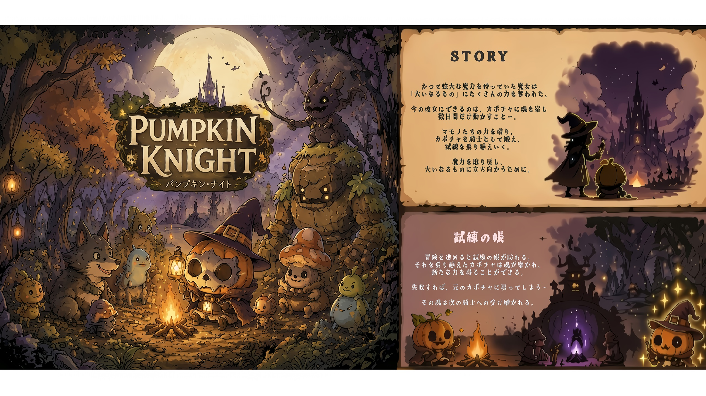

# PUMPKIN KNIGHT

『PUMPKIN KNIGHT』の公式紹介サイトです。

---

## Contents

### GAME INTRODUCTION **ゲーム紹介**

『PUMPKIN KNIGHT』は、魔女とカボチャの騎士が織りなす、ハロウィンをモチーフにしたオートバトル×ローグライトの育成ゲームです。

魔力を奪われた魔女は、残された力でカボチャに魂を宿しました。小さなカボチャの騎士は、魔女の魔力を取り戻すため、マモノたちの力を借りながら試練へと挑みます。

戦闘を通じて新たなスキルを獲得し、料理・錬成で能力を強化。特性やスキルを組み合わせることで、プレイごとに異なる成長や戦い方を楽しめます。

限られた時間の中で騎士を育て、挑戦で得た力を次の冒険へとつなぎながら、自分だけのビルドを作り上げていくのが本作の魅力です。

育成やビルド構築が好きな方、短時間で繰り返し遊べるローグライトが好きな方におすすめです。

----

### GAME SYSTEM **ゲームシステム**

### BATTLE & GROWTH **戦闘と育成**

オートバトルで魔物と戦い、経験を積んで成長。戦闘中に得られるスキルを組み合わせ、個性的な能力を持つ騎士を育てます。

### CRAFTING **料理・錬成**

森で集めた素材を使ってアイテムを作成。さまざまな効果を組み合わせ、冒険を有利に進めます。

### ROGUELITE **試練への挑戦**

限られた時間の中で成長と強化を繰り返し、試練と、その先に待つ強大な存在を目指します。

### SCREEN SHOT **スクリーンショット**

### DEMO MOVIE **ゲーム紹介動画**

https://www.youtube.com/@PUMPKINKNIGHTOfficialChannel

## Platform

- steam(展開予定)
- Nintendo Switch(展開予定)
- Nintendo Switch 2(展開予定)

## Developer

Mitsuru Yamaura

## License

All rights reserved.
